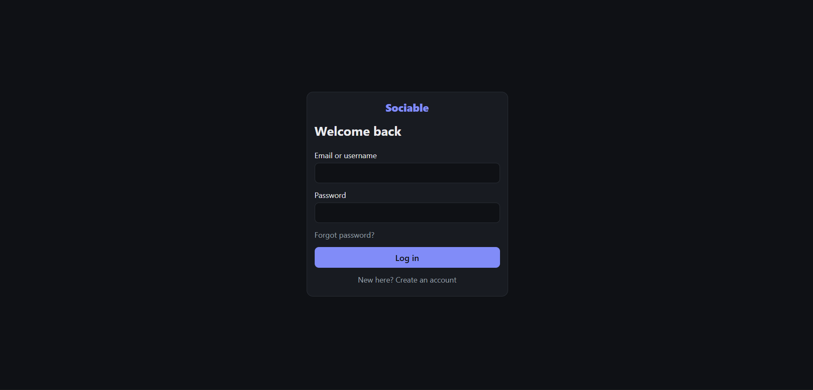
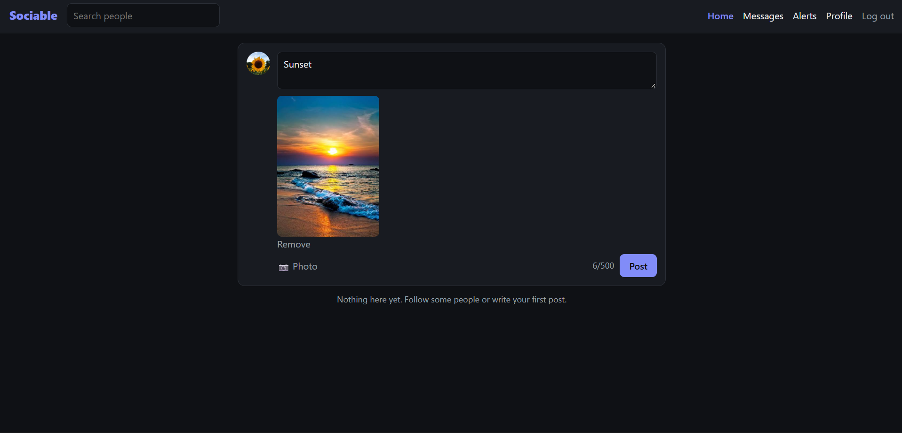
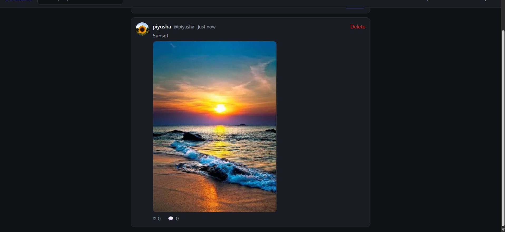
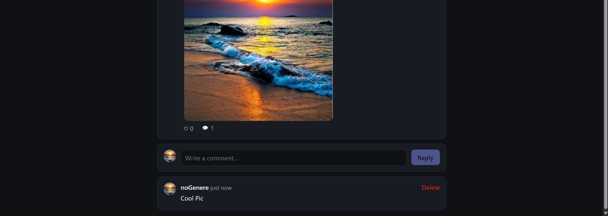
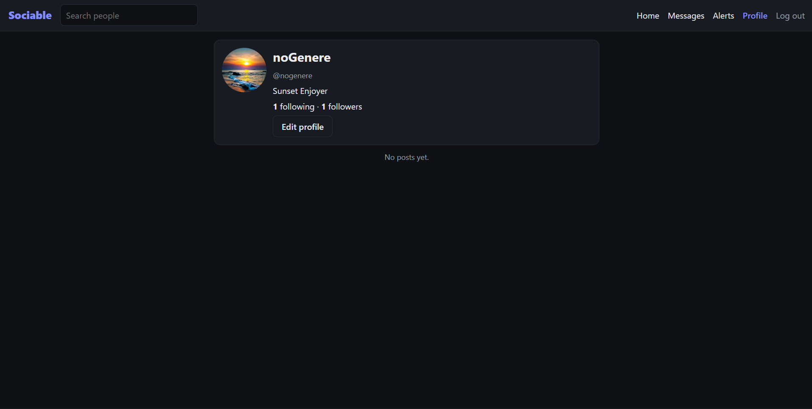
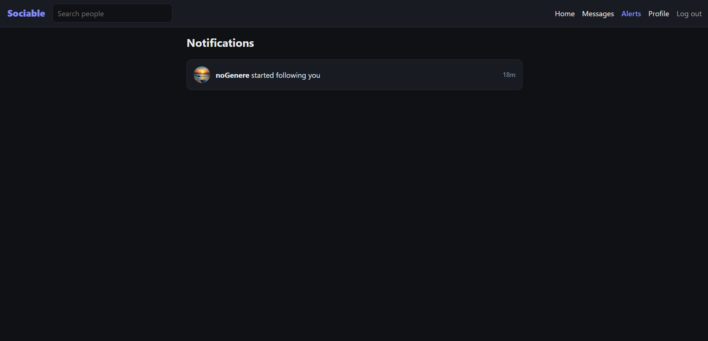
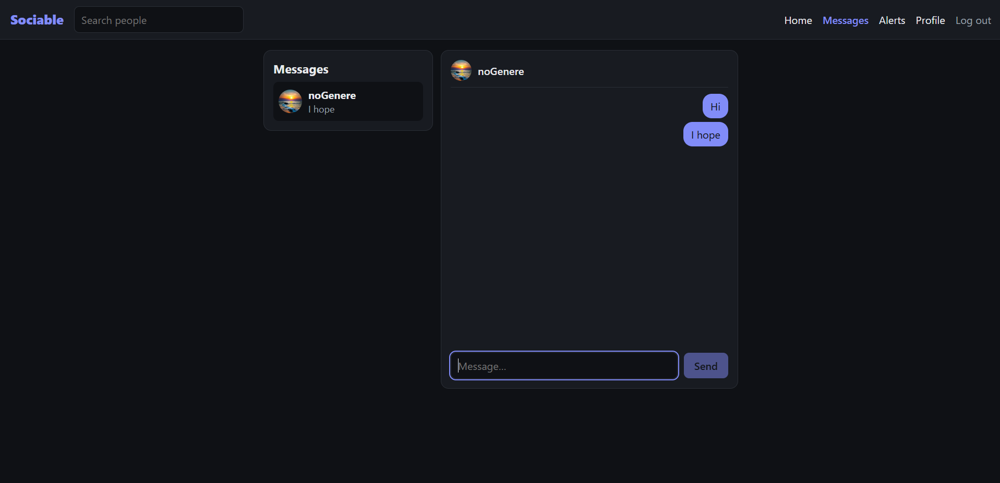
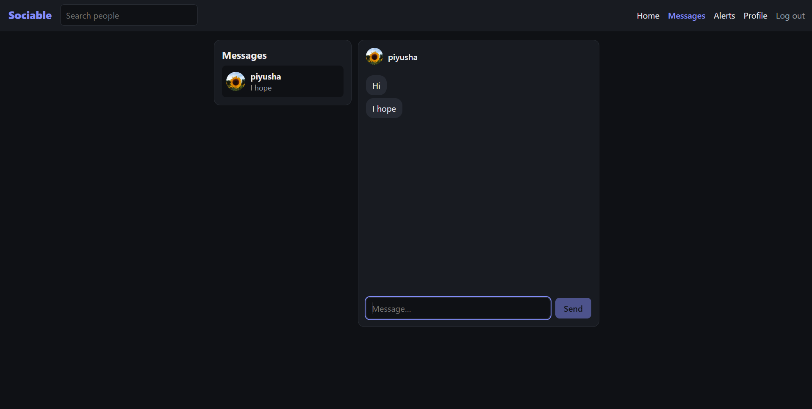

# Sociable — MERN social app


React 19 + Vite client, Express 5 + Mongoose API, MongoDB, JWT auth (httpOnly cookie), Socket.io for chat and notifications.

```
client/   React SPA (Vite). Dev server proxies /api, /uploads, /socket.io to :4000
server/   Express API + Socket.io + Mongoose models
docker-compose.yml   mongo + api + web (Caddy: static client, reverse proxy, automatic HTTPS)
```

## Screenshots
| | |
|---|---|
| <br>**Login** | <br>**Create a post with an image** |
| <br>**Image post** | <br>**Comments** |
| <br>**Profile** | <br>**Live notifications** |
| <br>**Real-time chat** | <br>**...and the other side** |

## Docs
- [Architecture](docs/ARCHITECTURE.md) — how it works and why (data model, auth, realtime, security)
- [Load testing guide](docs/LOADTEST.md) — k6 + socket scripts, how to read results
- [Quick live demo without a VPS](docs/DEPLOY-DEMO.md)

## Features
Register/login/logout · posts with optional image · feed (self + followed) with cursor pagination · likes · comments ·
follow/unfollow · profiles (bio, avatar) · user search · live notifications (like/comment/follow) · 1:1 chat with unread counts ·
email verification · password reset. Comments can be deleted only by their author.

## Local development
Needs Node 20+ and a MongoDB (e.g. `docker run -d -p 27017:27017 mongo:7`).

```bash
cd server && cp .env.example .env && npm install && npm run dev     # API on :4000
cd client && npm install && npm run dev                              # app on :5173
```
In development no SMTP is needed: verification and reset emails are **printed in the server console** (copy the link from there).

Tests (API + sockets): `cd server && npm test` (uses `TEST_MONGODB_URI` if set, else downloads a MongoDB binary via mongodb-memory-server).

## Deploy to a VPS
1. Point a DNS A record for your domain at the server; open ports 80 and 443. Install Docker + Compose.
2. `cp .env.example .env`, set `DOMAIN`, `APP_URL`, `JWT_SECRET` (`openssl rand -hex 48`) and the SMTP settings (next section). The API refuses to start in production without them.
3. `docker compose up -d --build`. Caddy obtains the TLS certificate on first start.

Use `DOMAIN=localhost` to try it locally (Caddy serves a self-signed cert on https://localhost; cookies are `Secure`).
Data lives in the named volumes `mongo_data` (database) and `uploads` (images) — **back both up**.
Update: `git pull && docker compose up -d --build`.

## Email / SMTP
SMTP is the protocol used to send email. Your app doesn't deliver mail itself; it logs in to a mail provider's SMTP server (host, port, username, password) and hands each message over. Don't run your own mail server: most VPS hosts block outbound port 25 and mail from an unknown IP lands in spam.

1. Pick a provider with SMTP access (e.g. Brevo, Resend, Mailgun, Amazon SES, or Gmail with an app password for small tests only).
2. Create SMTP credentials there and put them in `.env` (`SMTP_HOST`, `SMTP_PORT`=587, `SMTP_USER`, `SMTP_PASS`; use port 465 + `SMTP_SECURE=true` if the provider says so).
3. Verify your sending domain with the provider (adds SPF/DKIM DNS records) and set `MAIL_FROM` to an address on it. Without this, mail often goes to spam or is rejected.

Try the flows locally with Docker without any provider: `docker compose --profile local up --build` with `SMTP_HOST=mailpit`, `SMTP_PORT=1025`, then read the emails at http://localhost:8025.

## Security model (what is and isn't covered)
- Email links: random 256-bit tokens, only a SHA-256 hash is stored, single-use, 24h (verify) / 1h (reset). The forgot-password endpoint answers identically whether or not the account exists, and is rate limited. A password reset signs out every existing session and socket.
- Passwords: bcrypt (cost 12). Login timing doesn't reveal whether an account exists. Rate limits on login/register/posting/messaging.
- Session: JWT in an `httpOnly`, `SameSite=Lax`, `Secure` cookie (not readable by JS, so XSS can't steal it). The API requires JSON bodies, and Lax blocks cross-site cookie sends, which is the CSRF defence. **This depends on being served over HTTPS from one origin.**
- Input: every body/query validated with zod (also blocks NoSQL operator injection); React escapes output; CSP set by Caddy.
- Uploads: re-encoded with sharp (strips EXIF/GPS, validates real image data), size/pixel limits, random filenames, served with `nosniff`.
- Sockets: authenticated with the same cookie, Origin checked.
- MongoDB has no auth but isn't published outside the compose network. Don't expose 27017.

## Known limitations
- Single API instance only. Socket.io rooms are in-process; scaling out needs the Redis adapter and sticky sessions.
- No moderation/reporting/blocking, no account deletion, no change-email or change-password-while-logged-in, no read receipts in the UI.
- JWTs can't be revoked individually before expiry (7 days); logout only clears the cookie. Only a password reset revokes sessions.
- Images are on local disk (volume); no CDN.
