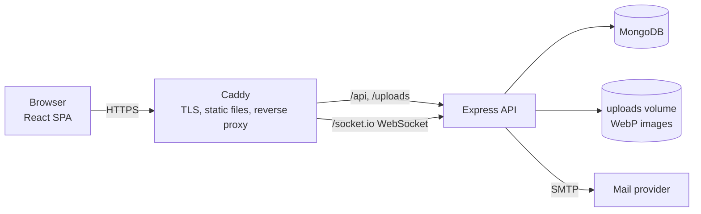
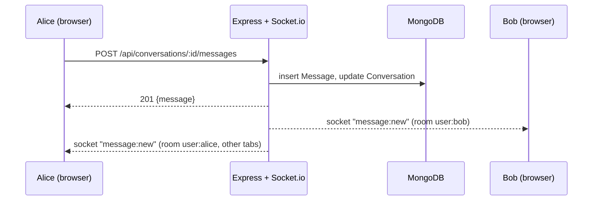

# Architecture

A guided tour of how the app works and why it is built this way. Read it with the code open.

## 1. Big picture



- **One origin.** The browser only talks to one host. Caddy serves the built React files and proxies `/api`, `/uploads` and `/socket.io` to the API. That is why cookies work without CORS and why CSRF protection can lean on `SameSite`.
- **Dev:** Vite's dev server plays Caddy's role through its proxy (`client/vite.config.js`).
- **Single-service mode:** with `CLIENT_DIR` set, Express serves the built client itself (used for simple PaaS deploys).

## 2. Repository layout

```
client/src/   React app: pages/, components/, auth.jsx (session), realtime.jsx (socket + badge counts), api.js (fetch wrapper)
server/src/
  index.js        boot: connect DB -> sync indexes -> check SMTP -> HTTP server -> attach Socket.io
  app.js          Express setup: security headers, rate limits, routes, error handler
  config.js       all environment variables, validated at startup
  models/         Mongoose schemas + indexes (one file)
  routes/         auth, users, posts, notifications, conversations
  middleware/     auth.js: authenticate(), requireAuth, requireVerified
  utils/          tokens, images, pagination, mailer, serialize, realtime, errors
  socket.js       Socket.io server + handshake auth
server/test/    integration tests (real MongoDB, real HTTP, real sockets)
```

## 3. Request lifecycle (REST)

`express.json` (20 KB cap) → cookie parser → rate limiter → router → **`requireAuth`** → handler → JSON.
Handlers validate input with **zod** (`utils/errors.js: parse`), which also rejects objects where strings are expected, so `{"$ne": ""}` style NoSQL-injection payloads fail with 400. Errors are thrown as `HttpError` (Express 5 forwards async errors automatically) and turned into JSON by one central `errorHandler`.

## 4. Authentication and sessions

- Register/login set a **JWT in an `httpOnly`, `SameSite=Lax`, `Secure` cookie**. JavaScript can't read it, so an XSS bug can't steal the token. The SPA never handles the token at all.
- `authenticate()` (in `middleware/auth.js`) verifies the token, loads the user, and rejects tokens issued before `passwordChangedAt`. The same function authenticates **REST requests and the WebSocket handshake**, so the two can't drift apart.
- Passwords: bcrypt cost 12. Login compares against a dummy hash when the account doesn't exist, so response time doesn't reveal which emails are registered.
- **Trade-off:** JWTs are stateless, so a single session can't be revoked early. Only a password reset invalidates sessions (via `passwordChangedAt`). A server-side session table would allow per-session logout at the cost of a DB read per request (which we already do to load the user).

## 5. Data model (`models/index.js`)

| Collection | Notes |
|---|---|
| `User` | username/email unique; denormalised `followerCount`/`followingCount`; `emailVerified`, `passwordChangedAt` |
| `Post` | author, text, image filename; denormalised `likeCount`/`commentCount`; index `{author, _id:-1}` |
| `Comment` | index `{post, _id:1}` |
| `Like`, `Follow` | **separate collections with a unique compound index**, not arrays inside `Post`/`User` |
| `Notification` | recipient, actor, type, post; index `{recipient, _id:-1}` |
| `Conversation`, `Message` | `pairKey` ("smallerId_largerId", unique) guarantees one conversation per pair |
| `EmailToken` | hashed single-use verify/reset tokens, TTL index deletes expired rows |

Why separate `Like`/`Follow` collections: arrays inside a document grow without bound (MongoDB's 16 MB document cap), can't enforce uniqueness cheaply, and make "did I like this?" an array scan. A unique index makes liking **idempotent**: the route does an upsert and only increments the counter when a row was really created (`upsertedCount === 1`), so double clicks and retries can't corrupt counts.

Counters are denormalised on purpose: reading a feed shouldn't `COUNT` likes per post. The cost: counter updates are separate writes from the row insert, so a crash between them can leave a count off by one. Acceptable for a social feed; a periodic reconcile job would fix drift.

## 6. Feed and pagination

- **Feed = fan-out on read:** `Post.find({author: {$in: [following..., me]}}).sort({_id:-1})`. Simple and always fresh. It gets slower as the number of followed accounts grows; large systems precompute timelines (fan-out on write). This is the most interesting scaling discussion in the project.
- **Cursor pagination** (`utils/pagination.js`): the client sends the last `_id` seen; the server queries `_id < cursor`, fetching `limit+1` rows to know whether a next page exists. Unlike `skip/limit`, it stays fast on deep pages and never shows duplicates when new posts arrive mid-scroll. ObjectIds are time-ordered, so `_id` order is chronological order.

## 7. Images (`utils/images.js`)

Upload → multer (memory, 5 MB cap, MIME allow-list) → **sharp re-encodes to WebP** → random filename on disk. Re-encoding is the real security control: the client-declared MIME type is untrusted, so decoding proves the bytes are an image, strips EXIF/GPS metadata, caps dimensions and pixel count (decompression-bomb guard), and neutralises polyglot files. Files are served with `nosniff` and immutable caching (names are random and never reused).

## 8. Real-time (Socket.io)



- **Writes go through REST, delivery goes through the socket.** The same validation, auth, rate limits and tests apply to every message; the socket is only a push channel. Sockets don't accept client-sent business events at all.
- Each user joins a private room `user:<id>` on connect. Notifications and messages are emitted to rooms, so a user with three tabs receives it in all of them.
- The handshake is authenticated from the cookie and the `Origin` header is checked (cross-site WebSocket hijacking defence).
- The client **re-fetches unread counts on every (re)connect**, because events sent while disconnected are not replayed. The database is the source of truth; sockets are an optimisation.
- **Limit:** rooms live in one process's memory. Running two API instances needs the Redis adapter (`@socket.io/redis-adapter`) and sticky sessions for long-polling fallbacks.

## 9. Email flows

Verification and password reset use **random 256-bit tokens; only the SHA-256 hash is stored**, so a database leak doesn't expose usable links. Tokens are single-use (atomic `findOneAndDelete`), expire (24 h / 1 h) and are replaced when a new one is issued. `forgot-password` answers identically whether or not the account exists and does its work after responding, so neither the body nor the timing leaks which emails are registered. Sending is rate-limited and throttled per account.

## 10. Security checklist (where each item lives)

| Concern | Control |
|---|---|
| XSS | React escapes output; strict CSP (`app.js` for Express, `Caddyfile` for static); httpOnly cookie |
| CSRF | `SameSite=Lax` cookie, JSON-only mutations, same-origin deployment |
| Injection | zod validation, no string-built queries, regex input escaped in search |
| Brute force / abuse | per-IP rate limits (login, register, email, posting, messaging) |
| Upload attacks | re-encode, size and pixel limits, random names, `nosniff` |
| Secrets | env vars only; production refuses to start with a weak `JWT_SECRET` or missing SMTP |
| Data exposure | `passwordHash` is `select: false`; public vs own-profile serialisers (`utils/serialize.js`) |

## 11. Testing

`server/test/api.test.js` spins up the real app on a random port against a real MongoDB (separate database per run, dropped afterwards) and exercises it over HTTP and WebSockets: auth, social graph, pagination, uploads, chat delivery, email flows, permission rules. CI runs it on every push (`.github/workflows/ci.yml`).

## 12. Known limitations / what I would do next

- Single API instance (Redis adapter for sockets, shared session/rate-limit store).
- No per-session revocation, no account deletion, no blocking/reporting, no change-email.
- Fan-out-on-read feed will need caching or precomputed timelines at scale.
- Images on local disk; object storage + CDN for multi-server setups.
- No observability beyond logs: add structured logging, metrics and error tracking.
